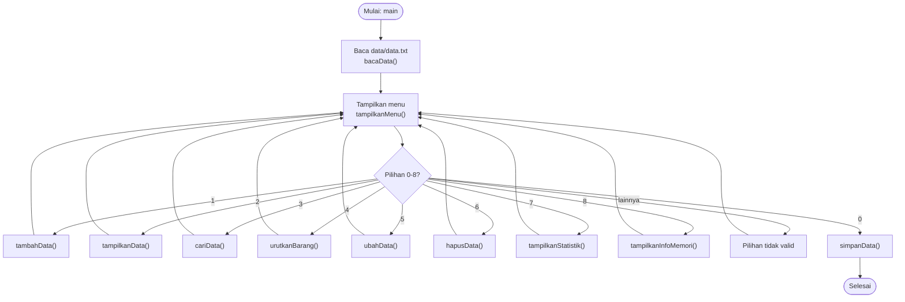
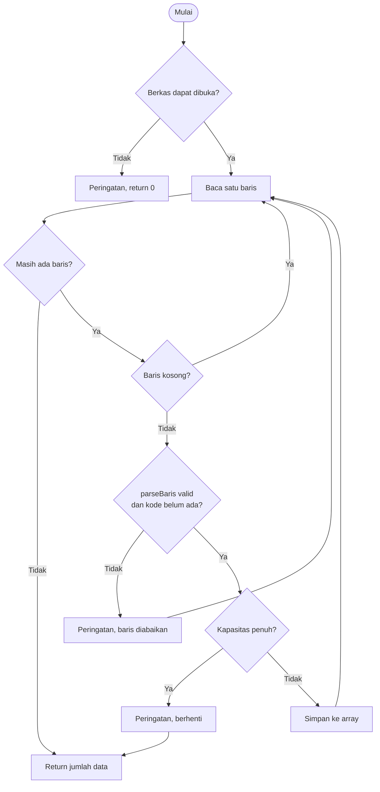
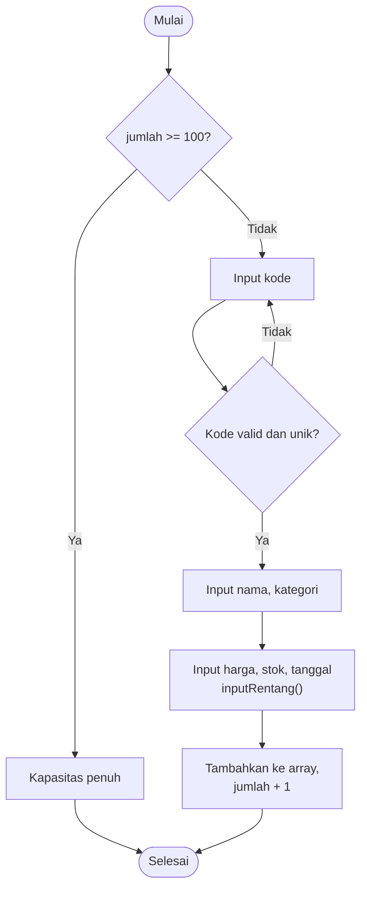

# Sistem Inventaris Warung Madura

Program konsol (CLI) berbasis **C++17** untuk mengelola data inventaris barang toko. Data disimpan dalam berkas teks, sehingga tetap ada setelah program ditutup. Proyek ini dibuat untuk UTS mata kuliah pemrograman dengan fokus pada `struct`, array, file I/O, pemrograman modular (file header), dan `Makefile`.

## Daftar Isi

1. [Fitur](#fitur)
2. [Struktur Proyek](#struktur-proyek)
3. [Instalasi dan Menjalankan](#instalasi-dan-menjalankan)
4. [Cara Penggunaan](#cara-penggunaan)
5. [Format Berkas Data](#format-berkas-data)
6. [Validasi Data](#validasi-data)
7. [Info Memori](#info-memori)
8. [Flowchart](#flowchart)
9. [Penjelasan Modul dan Fungsi](#penjelasan-modul-dan-fungsi)
10. [Batasan Program](#batasan-program)
11. [Anggota Kelompok](#anggota-kelompok)

## Fitur

| No | Menu | Fungsi |
|----|------|--------|
| 1 | Tambah data | Menambah barang baru dengan validasi input |
| 2 | Tampilkan seluruh data | Menampilkan semua barang dalam bentuk tabel |
| 3 | Cari data | Mencari berdasarkan kode, nama, atau kategori (tidak peka huruf besar/kecil) |
| 4 | Urutkan data | Mengurutkan naik berdasarkan harga, stok, atau nama |
| 5 | Ubah data | Mengubah nama, kategori, harga, stok, dan tanggal masuk |
| 6 | Hapus data | Menghapus barang dengan konfirmasi |
| 7 | Statistik | Jumlah jenis barang, total nilai stok, rata-rata harga, harga tertinggi, stok terendah |
| 8 | Info Memori | Menampilkan ukuran struct dan array dalam byte |
| 0 | Keluar | Menyimpan data ke berkas lalu menutup program |

## Struktur Proyek

```
.
├── Makefile
├── README.md
├── data/
│   └── data.txt          # berkas data (dibaca saat mulai, ditulis saat keluar)
├── include/
│   ├── data.h            # struct Barang, Tanggal, dan fungsi validasi/logika
│   ├── berkas.h          # fungsi baca dan simpan berkas
│   └── tampilan.h        # fungsi menu dan interaksi pengguna
└── src/
    ├── main.cpp          # program utama (loop menu)
    ├── data.cpp
    ├── berkas.cpp
    └── tampilan.cpp
```

> Folder `data/` harus sudah ada sebelum program dijalankan, karena program membuka `data/data.txt` relatif terhadap folder tempat program dijalankan.

## Instalasi dan Menjalankan

### Prasyarat

- Kompilator **g++** yang mendukung C++17 (GCC 7 atau lebih baru)
- **make**

### Linux (Ubuntu/Debian)

```bash
sudo apt update
sudo apt install build-essential
```

### macOS

```bash
xcode-select --install
```

### Windows

Gunakan salah satu:

- **WSL** (disarankan), lalu ikuti langkah Linux di atas, atau
- **MSYS2/MinGW-w64** dengan paket `mingw-w64-x86_64-gcc` dan `make` (perintah `mingw32-make`).

### Kompilasi dan jalankan

Jalankan dari folder utama proyek (yang berisi `Makefile`):

```bash
make          # kompilasi, menghasilkan program bernama "inventaris"
make run      # kompilasi (jika perlu) lalu jalankan
./inventaris  # atau jalankan langsung
make clean    # hapus program dan semua file .o
```

Opsi kompilasi yang dipakai: `g++ -std=c++17 -Wall -Wextra -pedantic -Iinclude`.

## Cara Penggunaan

Saat program dimulai, data valid dari `data/data.txt` dimuat, lalu menu tampil:

```
=== SISTEM INVENTARIS WARUNG MADURA ===
1. Tambah data
2. Tampilkan seluruh data
3. Cari data
4. Urutkan data
5. Ubah data
6. Hapus data
7. Statistik
8. Info Memori
0. Keluar
Pilihan:
```

Catatan penting:

- **Data baru hanya tersimpan ke berkas saat memilih `0` (Keluar)** atau saat input berakhir (Ctrl+D). Jika program ditutup paksa (Ctrl+C atau jendela ditutup), perubahan sejak program dibuka akan hilang.
- Pada menu **Ubah data**, kosongkan input (tekan Enter) untuk mempertahankan nilai lama. Input harga atau stok yang tidak valid akan diabaikan.
- Pada menu **Urutkan data**, pilih `1` untuk harga, `2` untuk stok, `3` untuk nama. Urutan selalu naik (ascending).
- Kode barang harus diawali `BRG`, hanya huruf/angka, maksimal 7 karakter (contoh: `BRG021`).

## Format Berkas Data

Setiap baris satu barang, kolom dipisahkan tanda `|`:

```
kode|nama|kategori|harga|stok|hari|bulan|tahun
```

Contoh:

```
BRG001|Beras Premium 5kg|Sembako|75000|20|1|1|2026
BRG004|Mie Instan Goreng|Makanan|3500|80|4|1|2026
```

Berkas contoh berisi 20 barang valid dan 3 baris rusak di bagian akhir yang sengaja dipakai untuk menguji validasi:

| Baris | Isi | Alasan ditolak |
|-------|-----|----------------|
| `SALAH\|Baris Harga Negatif\|...\|-5000\|...` | kode tidak diawali `BRG` dan harga negatif | tidak valid |
| `BRG123456\|Kode Terlalu Panjang\|...` | kode lebih dari 7 karakter | tidak valid |
| `BRG020\|Data Kode Duplikat\|...` | kode sudah dipakai `BRG020` pertama | duplikat |

Hasilnya, program memuat **20 data valid** dan mencetak peringatan di `stderr` untuk baris yang diabaikan.

## Validasi Data

| Field | Aturan |
|-------|--------|
| Kode | Diawali `BRG`, hanya huruf/angka, panjang 3 sampai 7, unik |
| Nama | Wajib diisi, maksimal 29 karakter |
| Kategori | Wajib diisi, maksimal 14 karakter |
| Harga | Bilangan bulat 0 sampai 100.000.000 |
| Stok | Bilangan bulat 0 sampai 10.000 |
| Tanggal masuk | Hari 1-31, bulan 1-12, tahun 2000-2100 |
| Kapasitas | Maksimal 100 barang |

## Info Memori

Menu **8** menampilkan ukuran struktur data di memori. Program memakai **array statis** `Barang data[100]`, jadi memori yang dipakai selalu tetap, berapa pun jumlah barang yang terisi.

```cpp
struct Tanggal {
    std::uint8_t  hari;     // 1 byte
    std::uint8_t  bulan;    // 1 byte
    std::uint16_t tahun;    // 2 byte
};

struct Barang {
    std::uint32_t harga;    // 4 byte
    Tanggal       tglMasuk; // 4 byte
    std::uint16_t stok;     // 2 byte
    char kode[8];           // 8 byte
    char nama[30];          // 30 byte
    char kategori[15];      // 15 byte
};
```

Perkiraan hasil pada platform 64-bit umum (x86-64, g++):

| Besaran | Ukuran |
|---------|--------|
| `sizeof(Tanggal)` | 4 byte |
| `sizeof(Barang)` | 64 byte |
| Kapasitas array | 100 record |
| `sizeof(array data)` | 6.400 byte |

Rincian `Barang`: 4 + 4 + 2 + 8 + 30 + 15 = 63 byte data, ditambah **1 byte padding** agar ukuran menjadi kelipatan 4 (mengikuti perataan `uint32_t`) sehingga totalnya 64 byte. Nilai pasti bisa berbeda antar kompilator atau arsitektur, jadi gunakan menu 8 untuk melihat hasil di komputermu.

Pemilihan tipe kecil (`uint8_t`, `uint16_t`) dan array `char` berukuran tetap bertujuan menghemat memori dan membuat ukuran record dapat diprediksi.

## Flowchart

### Alur utama program



### Alur membaca berkas (`bacaData`)



### Alur tambah data (`tambahData`)



## Penjelasan Modul dan Fungsi

### `data.h` / `data.cpp` : struktur dan logika data

| Fungsi | Kegunaan |
|--------|----------|
| `kodeValid` | Memeriksa format kode (awalan `BRG`, alfanumerik, panjang 3-7) |
| `tanggalValid` | Memeriksa rentang hari, bulan, tahun |
| `barangValid` | Gabungan semua pemeriksaan untuk satu barang |
| `kodeSudahAda` | Mencari apakah kode sudah dipakai |
| `cariDenganKode` | Mengembalikan indeks barang (atau -1 jika tidak ada) |
| `urutkanBarang` | Pengurutan **selection sort** menurut harga, stok, atau nama |
| `hapusBarang` | Menghapus dengan menggeser elemen ke kiri |
| `keHurufKecil`, `mengandungTanpaKapital` | Pencarian tanpa peka huruf besar/kecil |

### `berkas.h` / `berkas.cpp` : file I/O

| Fungsi | Kegunaan |
|--------|----------|
| `bacaData` | Membaca berkas, melewati baris rusak/duplikat, mengembalikan jumlah data valid |
| `simpanData` | Menulis seluruh data ke berkas dengan format `\|` |
| `parseBaris` (internal) | Memecah satu baris dan memvalidasi tiap kolom |
| `angka` (internal) | Mengubah teks menjadi bilangan dan menolak sisa karakter |

### `tampilan.h` / `tampilan.cpp` : antarmuka pengguna

| Fungsi | Kegunaan |
|--------|----------|
| `tampilkanMenu` | Mencetak menu utama |
| `tampilkanData` | Mencetak tabel seluruh barang |
| `tambahData`, `ubahData`, `hapusData` | Operasi tambah, ubah, hapus |
| `cariData` | Pencarian berdasarkan kata kunci |
| `tampilkanStatistik` | Ringkasan statistik inventaris |
| `tampilkanInfoMemori` | Ukuran struct dan array |
| `konfirmasi` | Pertanyaan y/n |
| `inputRentang`, `inputTanggal` (internal) | Input angka/tanggal dengan pengulangan sampai valid |

### `main.cpp` : program utama

Mendeklarasikan array `Barang data[KAPASITAS_DATA]`, memuat data awal, lalu menjalankan loop menu sampai pengguna memilih `0` atau input berakhir.

### Konsep yang dipakai

- `struct` bersarang (`Barang` berisi `Tanggal`)
- Array statis dan operasi array (tambah, hapus dengan geser, cari linear, selection sort)
- Pass by reference (`size_t& jumlah`) agar jumlah data dapat diubah di fungsi lain
- File I/O dengan `ifstream` dan `ofstream`
- Parsing teks dengan `stringstream` dan `getline` berpembatas `|`
- Pemrograman modular: file header dengan *include guard* dan `Makefile`

## Batasan Program

- Kapasitas maksimal 100 barang (array tetap).
- Data baru baru tersimpan saat keluar lewat menu `0` atau saat input berakhir.
- Nama dan kategori tidak boleh mengandung karakter `|` karena dipakai sebagai pemisah berkas.
- Pengurutan hanya naik dan mengubah urutan data di memori (dan berkas saat disimpan).
- Pesan peringatan saat membaca berkas dicetak ke `stderr`.

## Anggota Kelompok

| Nama | NIM | Peran |
|------|-----|-------|
| (isi nama) | (isi NIM) | (isi peran) |
| (isi nama) | (isi NIM) | (isi peran) |
